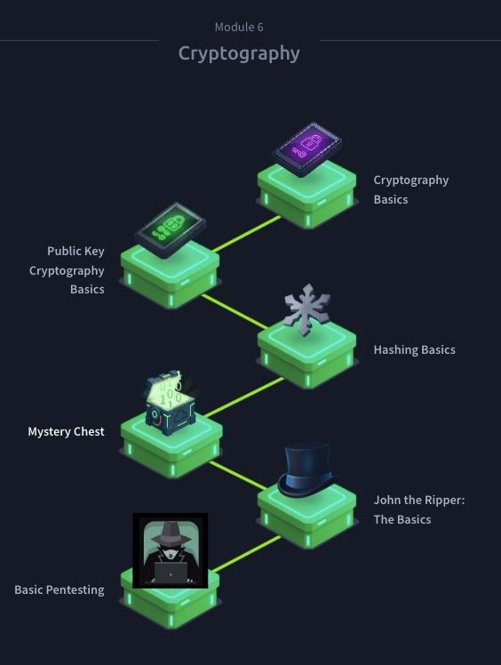

# Cryptography


- [Cryptography Basics](https://tryhackme.com/room/cryptographybasics?utm_campaign=social_share&utm_medium=social&utm_content=share-completed-room&utm_source=copy&sharerId=68732000650a30c56e43c983)
- [Public Key Cryptography Basics](https://tryhackme.com/room/publickeycrypto?utm_campaign=social_share&utm_medium=social&utm_content=share-completed-room&utm_source=copy&sharerId=68732000650a30c56e43c983)
- [Hashing Basics](https://tryhackme.com/room/hashingbasics?utm_campaign=social_share&utm_medium=social&utm_content=share-completed-room&utm_source=copy&sharerId=68732000650a30c56e43c983)
- [John the Ripper: The Basics](https://tryhackme.com/room/johntheripperbasics?utm_campaign=social_share&utm_medium=social&utm_content=share-completed-room&utm_source=copy&sharerId=68732000650a30c56e43c983)

## What I Did
Completed 6 hands-on rooms covering the fundamentals of cryptography and password cracking.

**Command example of John the Ripper:** ```john --format=raw-md5 --wordlist=/usr/share/wordlists/rockyou.txt hash_to_crack.txt```

## Key Takeaways (SOC Focus)
- **Encryption:** Understand the difference between Symmetric and Asymmetric encryption.
- **Hashing:** Learned how hashing ensures integrity and how to identify hash types (MD5, SHA-256).
- **Password Cracking:** Used **John the Ripper** to crack hashes. This showed me why strong passwords, salting, and MFA are critical for defense.
- **Pentesting:** Applied these skills in a basic pentest lab to gain initial access to a machine.

## Why It Matters
As a SOC Analyst, I need to understand how attackers break encryption and steal credentials in order to detect it. 
