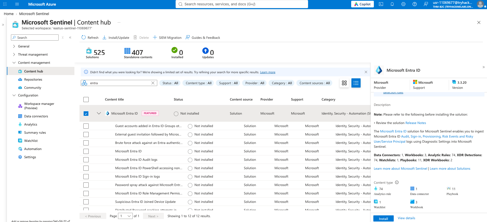
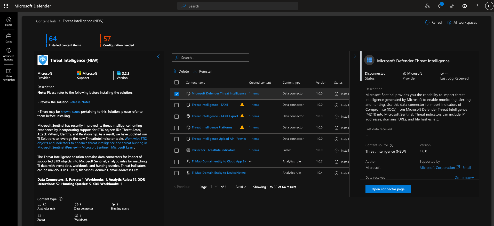

# Defending Azure: Sentinel Content Hub & Connectors

Setting up the initial workspace and getting data flowing into Sentinel. 

## What I Did
Used the **Content Hub** to search for solutions. I installed the **Microsoft Entra ID** solution first because I wanted to get identity logs (sign-ins, audits) flowing. Then I went to the **Microsoft Defender Threat Intelligence** solution and started configuring the data connectors.

## Key Takeaways
- **Content Hub:** It's basically an app store for Sentinel. Installing a solution doesn't just add the data connector, it also imports pre-built analytic rules, workbooks, and hunting queries. 
- **Connectors:** There are different ways to ingest data. Some are native (like Entra ID), and some require setting up an API or agent.
- **Configuration Needed:** Installing the solution is only step one. You still have to go to the data connector page and actually turn it on so logs start flowing. 

## Why It Matters for SOC
You can't hunt for threats if you don't have the data. Setting up the right connectors and importing the correct solutions is the foundation of everything a SOC analyst does in Sentinel. 
