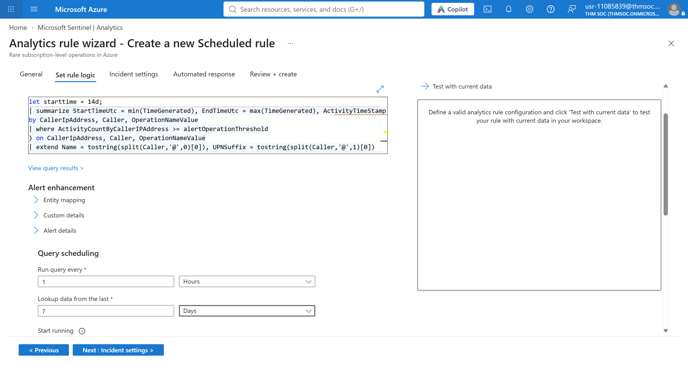
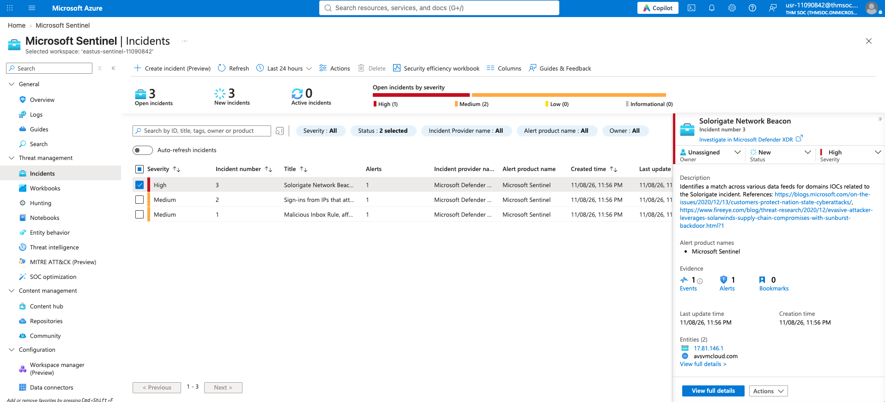
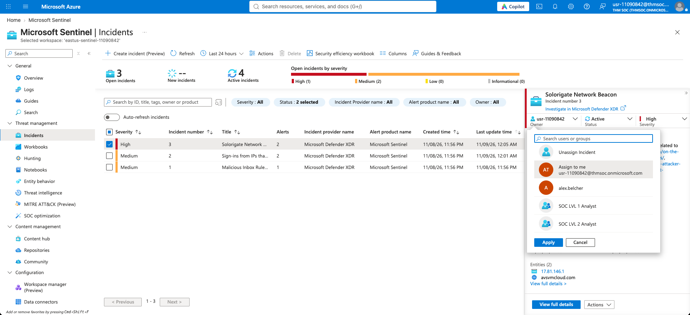
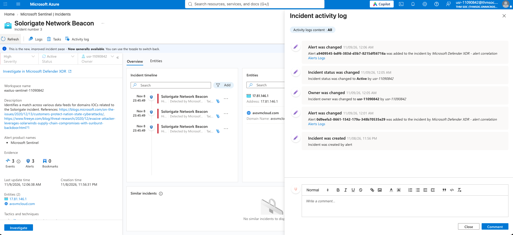
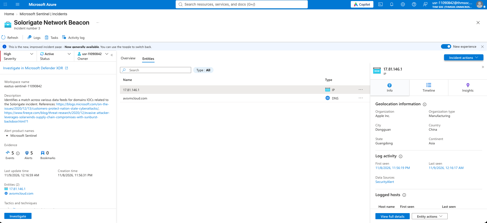
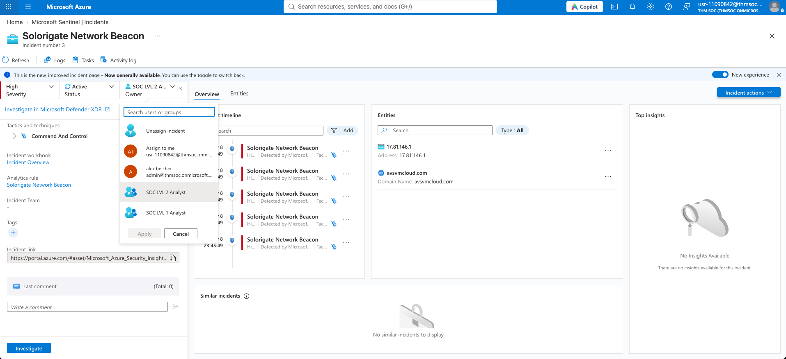

Two different labs done here. The first one was all about setting up detection, and the second one was a totally separate lab focused on investigating an incident.

## Lab 1: Creating an Analytic Rule

In the first lab, I learned how to create a Scheduled Analytic Rule using a template. I didn't write the query from scratch, but I modified the KQL logic and set the query schedule (running every 1 hour, looking back 7 days). I also had to set up entity mapping so Sentinel knew which parts of the logs (like IP addresses or users) were important to track.

## Lab 2: Investigating an Incident
This one wasn't related to the first lab at all. I got a pre-made "Solorigate Network Beacon" incident and had to act like an analyst. 

- **Entities:** When I opened the incident, Sentinel automatically extracted the attacker IP (`17.81.146.1`) and the domain (`avsvmcloud.com`). Super helpful for pivoting.
- **Triage:** I learned how to assign the incident to myself, change the status to "Active", and create an investigation task to be escalated to Tier-2 analysts (like "Tier-2 Threat Hunting required for IP entity").
- **Logs:** I opened the Logs window to look at the actual KQL query that triggered the alert. It was searching for specific IOC domains in the network logs. 
- **Activity Log:** Everything you do is tracked in the Activity Log on the right side, which is good for audit trails.

## Why It Matters for SOC
Setting up the rules is one thing, but actually triaging the alert and documenting your steps is the real daily workflow of a SOC Analyst.
