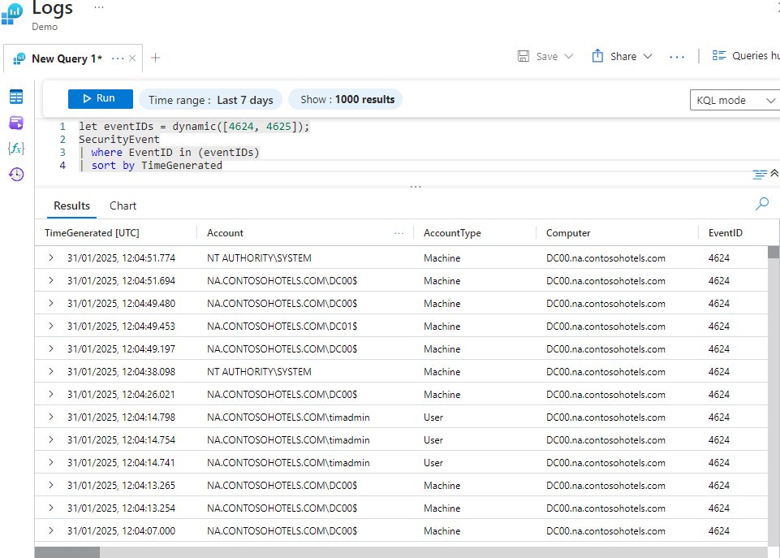
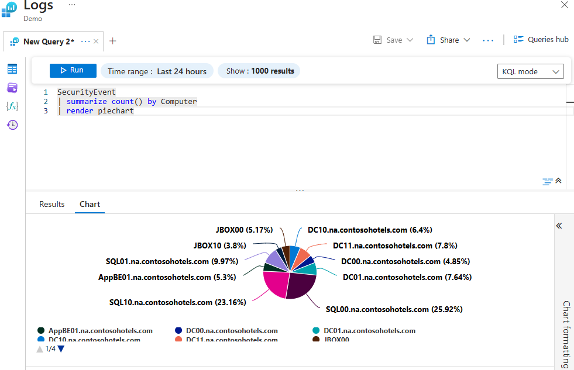
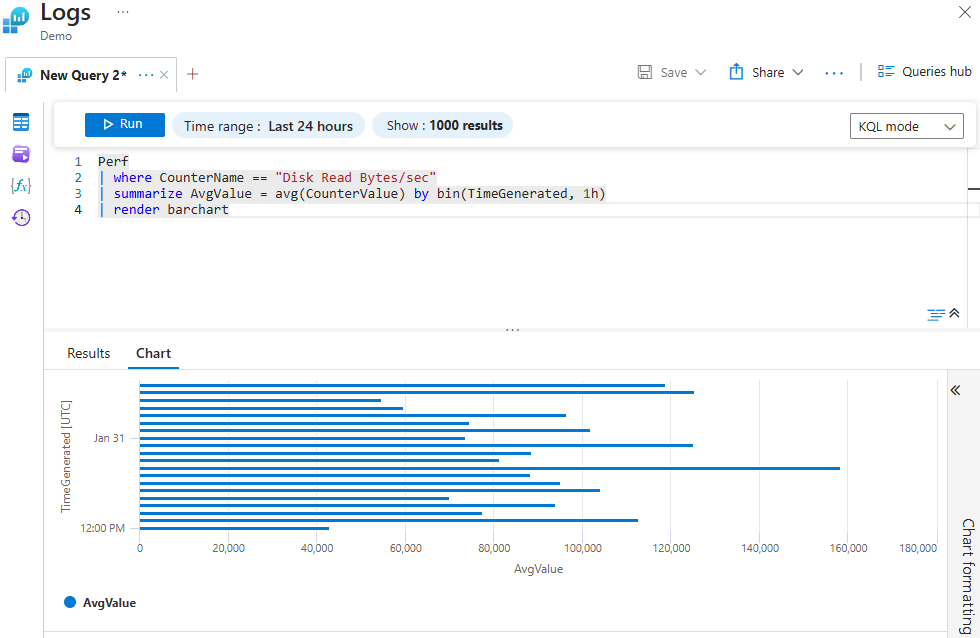
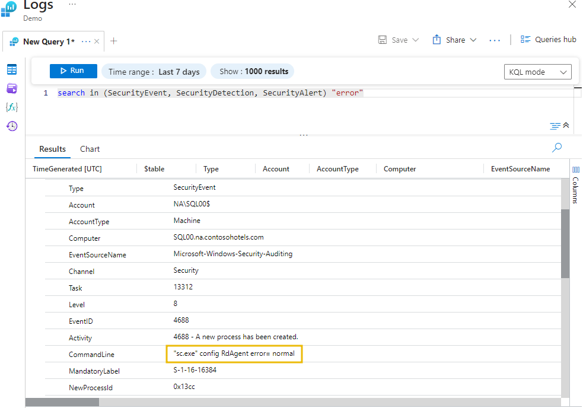
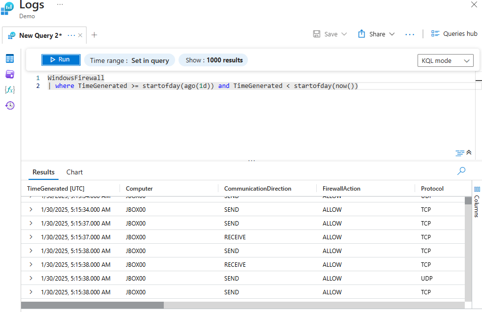
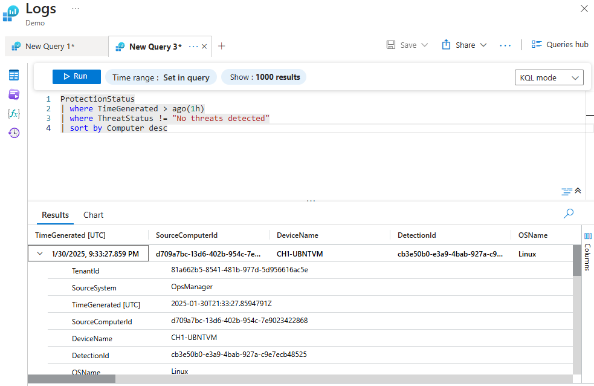
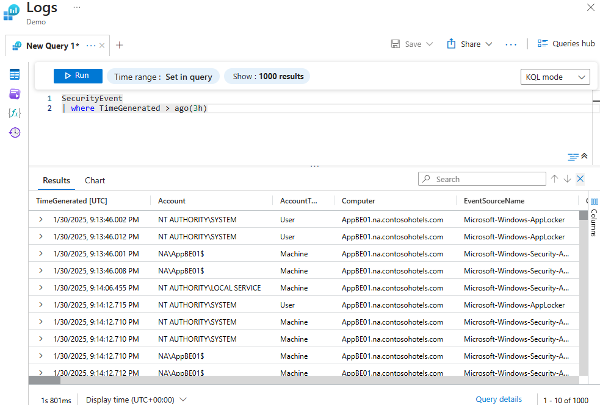

This lab was a deep dive into different KQL operators. It covered how to filter logs, look for specific timeframes, visualize data with charts, and search across multiple tables at once.

## Dynamic Arrays & Filtering (in)


I learned how to create a dynamic array using `let` to store multiple Event IDs, and then use the `in` operator to filter for them. This is super handy when you want to look for more than one specific event at a time.

```kusto
let eventIDs = dynamic([4624, 4625]);
SecurityEvent
| where EventID in (eventIDs)
| sort by TimeGenerated
```
## Visualizing Data (render)



I used the `summarize` operator combined with `bin` to group data into hourly chunks, and then used `render barchart` to visualize it. I also used `render piechart` to see the count of events by computer.
```kusto
// Bar chart example
Perf
| where CounterName == "Disk Read Bytes/sec"
| summarize AvgValue = avg(CounterValue) by bin(TimeGenerated, 1h)
| render barchart
```
```kusto
// Pie chart example
SecurityEvent
| summarize count() by Computer
| render piechart
```
## Searching Across Tables (search)

The 'search' operator is a quick way to look for a keyword across multiple tables at once (like SecurityEvent, SecurityDetection, and SecurityAlert). In this case, searching for "error" found a suspicious command line execution (`sc.exe config RdAgent error= normal`).
```kusto
search in (SecurityEvent, SecurityDetection, SecurityAlert) "error"
```
## Time-based Filtering (ago, startofday)




I learned several ways to filter by time. You can use `ago()` for relative time (like the last hour), or `startofday()` to get everything since midnight. Using `!=` is also useful to exclude specific statuses.
```kusto
// Filtering for recent events
ProtectionStatus
| where TimeGenerated > ago(1h)
| where ThreatStatus != "No threats detected"
| sort by Computer desc
```
```kusto
// Filtering for specific day
WindowsFirewall
| where TimeGenerated >= startofday(ago(1d)) and TimeGenerated < startofday(now())
```
```kusto
// Filtering last 3 hours
SecurityEvent
| where TimeGenerated > ago(3h)
