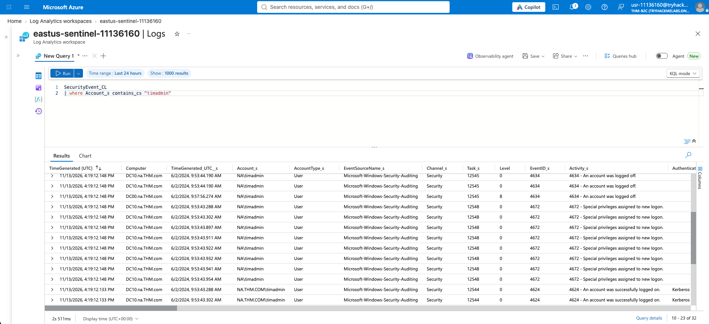
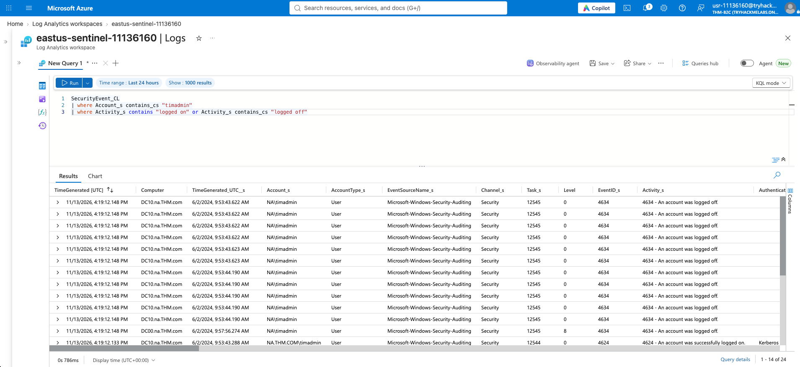
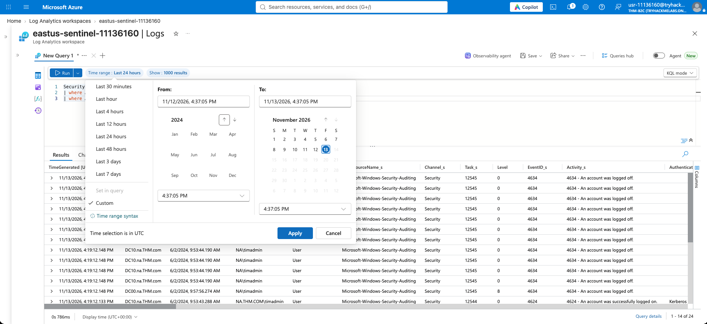
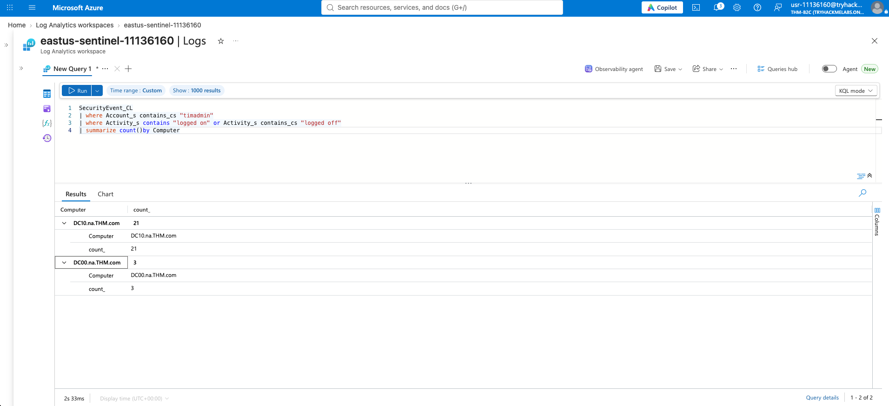
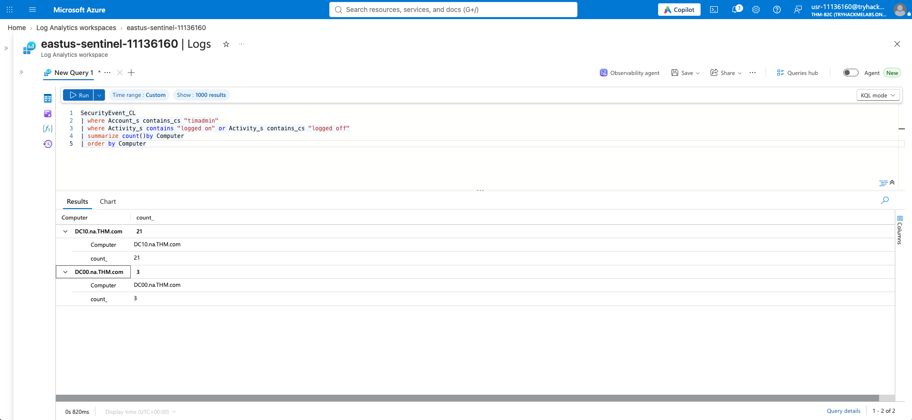

This lab was focused on the investigation process in Sentinel. It was about using the logs to identify suspicious activity for a specific user and then using that data to make a decision.

## Step 1: Identifying the User's Activity

The first step was to search for all the security events related to the `timadmin` account to see what they were doing. I used a simple `where` clause to filter for the account name.

```kusto
SecurityEvent_CL
| where Account_s contains_cs "timadmin"
```
After pulling the initial logs, I scrolled through the `Activity_s` column to see if there was anything that stood out as suspicious or unusual for an admin account.

## Step 2: Investigating the Logins by Machine




To get a better picture of the scope, I extended the time range. Then I filtered specifically for log-on and log-off events and grouped them by the `Computer` name. This helps identify which machines the user is logging into the most.
```kusto
SecurityEvent_CL
| where Account_s contains_cs "timadmin"
| where Activity_s contains "logged on" or Activity_s contains "logged off"
| summarize count() by Computer
| order by Computer
```
The results showed 21 log events on DC10 and 3 events on DC00.

Investigation & Recommendations
The next step is to verify if `timadmin` is actually supposed to have access to those specific machines. If the logins don't match his normal daily tasks or the times look weird, that's a red flag.

Recommendations based on the findings:

* Have Tim reset his admin credentials and ensure a strong password is used.

* Review his access to critical workloads.

* Scan the affected workloads for malware.

* If there's any doubt, disable the account to prevent further access.

## Why It Matters for SOC
Investigating an alert isn't just about reading a single log. It's about using KQL to gather context, identify patterns (like which machines are being accessed), and then making a recommendation based on that evidence.
