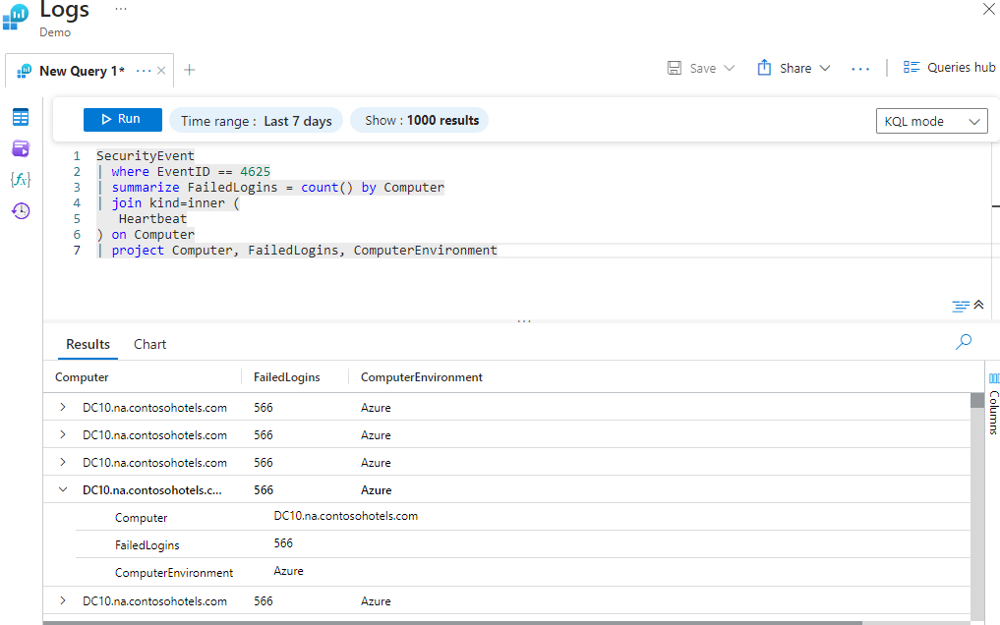
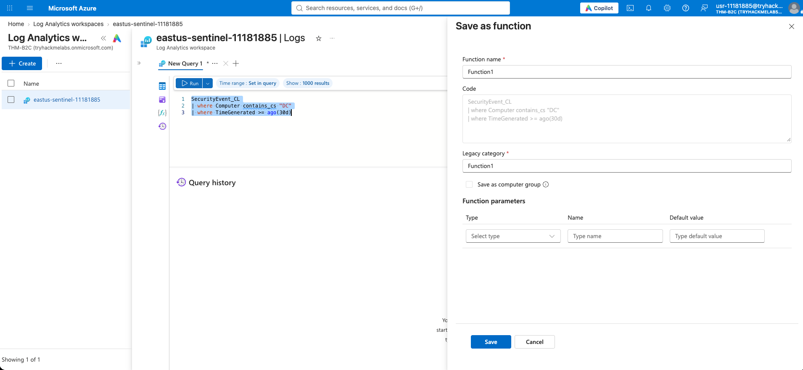
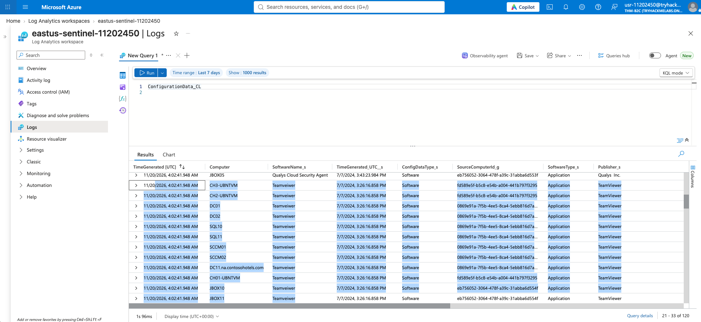
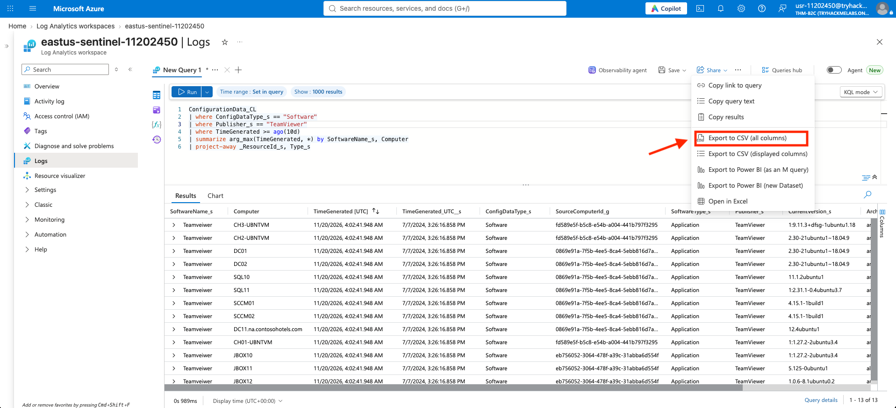
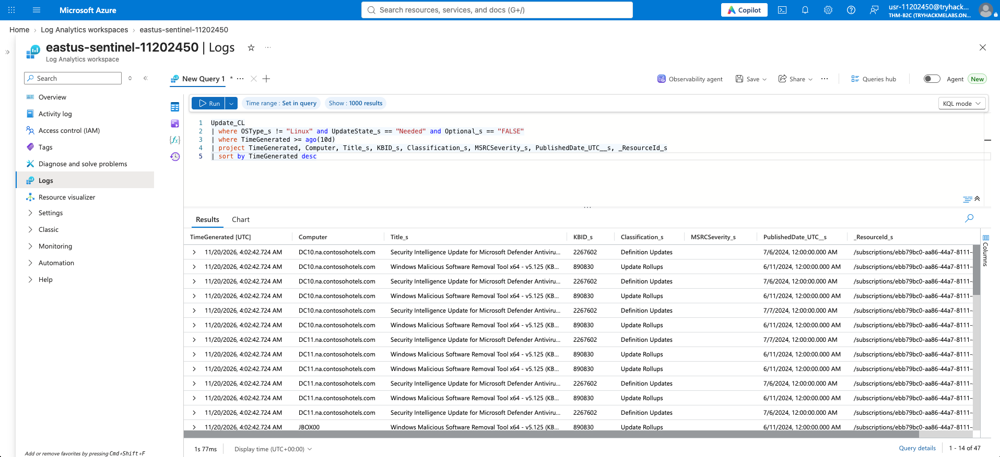

This room was a deep dive into some of the more advanced KQL operators like `join`, `union`, `project`, `extend`, and `parse`. It also covered how to save queries as "Parsers" (Functions) to reuse them later.

## Key Concepts Learned

*   **`project` / `project-away`:** Used to select or hide specific columns so the output isn't a mess of 50 different fields.
*   **`extend`:** Used to create a brand new calculated column (like turning Event IDs into readable text using `case()`).
*   **`parse`:** Used to extract specific data (like IP addresses or ports) out of a giant, messy text block (like the XML `EventData` field).
*   **`join`:** Used to combine data from two completely different tables based on a shared column (like an IP address or Computer name).
*   
*   **`union`:** Used to stack two tables on top of each other, but it requires the columns to be named the same or you get a lot of nulls.
*   **Parsers (Functions):** Saved queries that act like virtual tables. You can save a long query as a function (e.g., `Function1`) and just type that name next time to run the whole thing.
  I saved a query as a function. I wrote a query to look for "DC" servers and saved it as `Function1`.
```kusto
SecurityEvent_CL
| where Computer contains_cs "DC"
| where TimeGenerated >= ago(30d)
```

---

## The Lab Scenario: The TeamViewer Incident

**Context:** The organization doesn't support TeamViewer, but we got news it might be compromised. I had to act as the SOC engineer to find all the VMs that had it installed, check for pending updates, and export the results.

### Step 1 & 2: Finding Machines with TeamViewer
I logged into the Azure Log Analytics workspace and went to the Logs blade. To find the machines, I queried the `ConfigurationData_CL` table (which holds software inventory data).

I filtered the table to find the specific software and exported the results to a CSV.

```kusto
ConfigurationData_CL
| where ConfigDataType_s == "Software"
| where Publisher_s == "TeamViewer"
| where TimeGenerated >= ago(10d)
| summarize arg_max(TimeGenerated, *) by SoftwareName_s, Computer
| project-away _ResourceId_s, Type_s
```


## Step 3: Verifying Pending Updates
Next, I needed to see if these machines were missing any patches. I switched to the `Update_CL` table and filtered for machines that had a status of "Needed" and weren't optional updates.
```kusto
Update_CL
| where OSType_s != "Linux" and UpdateState_s == "Needed" and Optional_s == "FALSE"
| where TimeGenerated >= ago(10d)
| project TimeGenerated, Computer, Title_s, KBID_s, Classification_s, MSRCSeverity_s, PublishedDate_UTC_s, _ResourceId_s
| sort by TimeGenerated desc
```


## Recommendations to the Update Management Team
Based on the investigation, the next steps are:

1. Uninstall TeamViewer: Send the exported CSV of affected machines to the device management team so they can remove the software.
2. Patch Servers: Pass the CSV of pending updates to the update management team and request they patch the servers ASAP.
3. Automate: Save the query as a function so we can run it quickly in the future to ensure no one reinstalls TeamViewer.
